# Đặc tả yêu cầu phần mềm — Hệ thống quản lý nuôi trồng nấm thông minh

## I. Tổng quan dự án

### 1. Mục tiêu

Hệ thống giúp trang trại quản lý phòng, khay, thiết bị, điều kiện môi trường, hoạt động cho thuê và thu hoạch. Khách hàng dùng ứng dụng di động để thuê và theo dõi khay của mình; nhân viên vận hành dùng Web để quản lý trang trại và xử lý bất thường; quản trị viên quản lý tài khoản, gói thuê và các chức năng quản trị.

**Luồng nghiệp vụ trung tâm:** Customer đăng ký/xác minh tài khoản → gửi yêu cầu thuê → Operator/Admin duyệt và gán khay → Customer liên kết khay → ESP32 gửi số liệu → hệ thống hiển thị/cảnh báo → Operator/Admin điều khiển, cập nhật tiến độ và thu hoạch.

### 2. Phạm vi

**Phiên bản phải triển khai** gồm: tài khoản và phân quyền; phòng, khay, gói thuê; yêu cầu thuê, gán và liên kết khay; thu thập dữ liệu môi trường phòng qua ESP32; cấu hình ngưỡng và cảnh báo; điều khiển thiết bị thủ công có xác nhận; cập nhật tiến độ, lịch và kết quả thu hoạch. Đây là một chu trình sử dụng hoàn chỉnh từ lúc khách hàng đăng ký đến khi theo dõi kết quả thu hoạch.

**Chức năng có thể phát triển sau khi hoàn tất phiên bản trên:** hồ sơ và khôi phục mật khẩu đầy đủ; lịch sử và thông báo; yêu cầu nhận/giao thu hoạch; camera trực tiếp; điều khiển tự động; báo cáo và xuất CSV. Các chức năng này không được tính là đã hoàn thành chỉ vì có màn hình hoặc dữ liệu mô phỏng.

**Ngoài phạm vi:** thanh toán/hoàn tiền thật, AI chẩn đoán, lưu video, thương mại điện tử và logistics đầy đủ. Giá gói thuê chỉ phục vụ mô phỏng nghiệp vụ, không tạo giao dịch tiền thật.

### 3. Giả định và ràng buộc

- Backend Java/Spring Boot, PostgreSQL, REST API; Web ReactJS cho Administrator/Farm Operator; Mobile Flutter cho Customer; ESP32 gửi/nhận dữ liệu qua MQTT/TLS; WebSocket cập nhật giao diện.
- Mỗi khay và thiết bị có mã định danh duy nhất. Thiết bị phải được đăng ký với một phòng và có credential riêng trước khi trao đổi MQTT.
- Cảm biến đo **môi trường phòng trồng**, không đo riêng từng khay. Customer chỉ thấy dữ liệu phòng chứa khay có lease ACTIVE và liên kết hợp lệ của mình.
- Ngưỡng nhiệt độ, độ ẩm, CO₂ dùng chung toàn trang trại, do Admin/Operator thiết lập; không hard-code giá trị mặc định. Nếu triển khai camera, hệ thống chỉ phát trực tiếp qua gateway, không ghi video.
- Quy mô kiểm thử: 5 phòng, 50 khay, 50 thiết bị, 10 người dùng đồng thời. Chu kỳ gửi telemetry mặc định 30 giây.
- Administrator kế thừa quyền nghiệp vụ của Operator; tài khoản Admin đầu tiên được khởi tạo qua quy trình được ủy quyền, không qua đăng ký công khai.

## II. Yêu cầu chức năng

### 1. Các tác nhân

| Tác nhân                               | Vai trò và giới hạn                                                                                                                                                                                             |
| -------------------------------------- | --------------------------------------------------------------------------------------------------------------------------------------------------------------------------------------------------------------- |
| **Administrator (Quản trị viên)**      | Có quyền vận hành của Operator; riêng Admin được quản lý tài khoản/vai trò và gói thuê. Nếu có báo cáo, chỉ Admin được xem/xuất.                                                                                |
| **Farm Operator (Nhân viên vận hành)** | Quản lý phòng/khay trong phạm vi công việc, duyệt và gán khay, giám sát IoT, cấu hình ngưỡng, xử lý cảnh báo/lệnh, cập nhật tiến độ và thu hoạch. Không quản lý tài khoản/vai trò hoặc gói thuê.                |
| **Customer (Khách hàng)**              | Xem gói thuê, đăng ký, xác minh email và đăng nhập; sau khi đủ điều kiện, thuê/liên kết và xem khay của mình, môi trường/tiến độ/lịch thu hoạch trong phạm vi thuê. Không điều khiển thiết bị hoặc thay ngưỡng. |

Các API bảo vệ phải kiểm tra vai trò **và quyền trên tài nguyên ở backend**. Phiên chưa hợp lệ trả 401; người đã đăng nhập nhưng không đủ quyền trả 403. Không suy quyền từ dữ liệu do client gửi. API công khai chỉ cung cấp gói thuê đang hoạt động và thao tác đăng ký/đăng nhập/xác minh.

### 2. Các chức năng chính

| Nhóm                 | Người sử dụng             | Yêu cầu cần triển khai                                                                                                                           | Kết quả kiểm tra được                                                                                                                       |
| -------------------- | ------------------------- | ------------------------------------------------------------------------------------------------------------------------------------------------ | ------------------------------------------------------------------------------------------------------------------------------------------- |
| Tài khoản            | Customer, Admin, Operator | Customer đăng ký, xác minh email và đăng nhập; Admin tạo, cập nhật, vô hiệu hóa tài khoản, gán vai trò và đặt lại mật khẩu.                      | Tài khoản chưa xác minh không thuê được; tài khoản bị vô hiệu hóa không đăng nhập được; mỗi vai trò chỉ thực hiện được quyền của mình.      |
| Quản lý trang trại   | Admin, Operator, Customer | Quản lý phòng và khay; chỉ Admin quản lý gói thuê; Customer xem được gói đang hoạt động ngay cả khi chưa đăng nhập.                              | Mã khay không trùng; phòng/khay đang có quan hệ sử dụng không bị xóa cứng; gói ngừng hoạt động không thể chọn để thuê.                      |
| Thuê khay            | Customer, Admin, Operator | Customer gửi yêu cầu 1–5 khay; Operator/Admin duyệt hoặc từ chối, gán khay và cấp mã liên kết; Customer dùng mã để kích hoạt quyền xem.          | Không gán trùng khay; mã chỉ dùng một lần trong 24 giờ; Customer chỉ xem khay thuộc hợp đồng đang hoạt động của mình.                       |
| Giám sát môi trường  | Admin, Operator, Customer | Đăng ký thiết bị theo phòng; nhận và lưu nhiệt độ, độ ẩm, CO₂ từ ESP32; hiển thị số liệu và thời điểm đo; cấu hình ngưỡng và phát hiện cảnh báo. | Mẫu trùng không được lưu hai lần; dữ liệu cũ hoặc thiếu ngưỡng được hiển thị rõ; Customer chỉ thấy môi trường phòng có khay mình đang thuê. |
| Điều khiển thủ công  | Admin, Operator           | Người vận hành gửi lệnh đến ESP32; hệ thống lưu lệnh, chờ ACK và cập nhật kết quả.                                                               | Customer không gửi được lệnh; không có ACK thì không hiển thị thành công.                                                                   |
| Tiến độ và thu hoạch | Admin, Operator, Customer | Nhân viên cập nhật giai đoạn, lịch dự kiến và kết quả thu hoạch; Customer xem dữ liệu khay của mình.                                             | Lịch dự kiến tách biệt kết quả thực tế; người không có quyền không sửa hoặc xem chéo dữ liệu.                                               |

**Quy tắc bắt buộc:** email duy nhất và xác minh trước khi thuê; mật khẩu hash Argon2id, tối thiểu 12 ký tự; access token 30 phút, refresh session 7 ngày; sai mật khẩu 5 lần trong 15 phút thì khóa 15 phút. Phòng/khay có lịch sử hoặc quan hệ sử dụng không xóa cứng. Một khay chỉ có tối đa một lease ACTIVE. Giao dịch thuê chỉ mô phỏng, không thu/hoàn tiền.

### 3. Sơ đồ tác nhân và Use Case tổng quan

**Quan hệ tác nhân.**
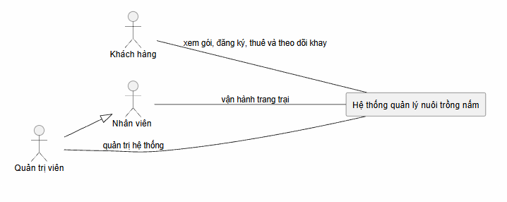

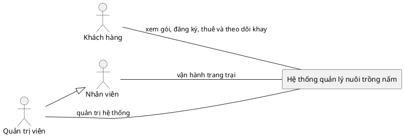

**Use Case tổng quan.**


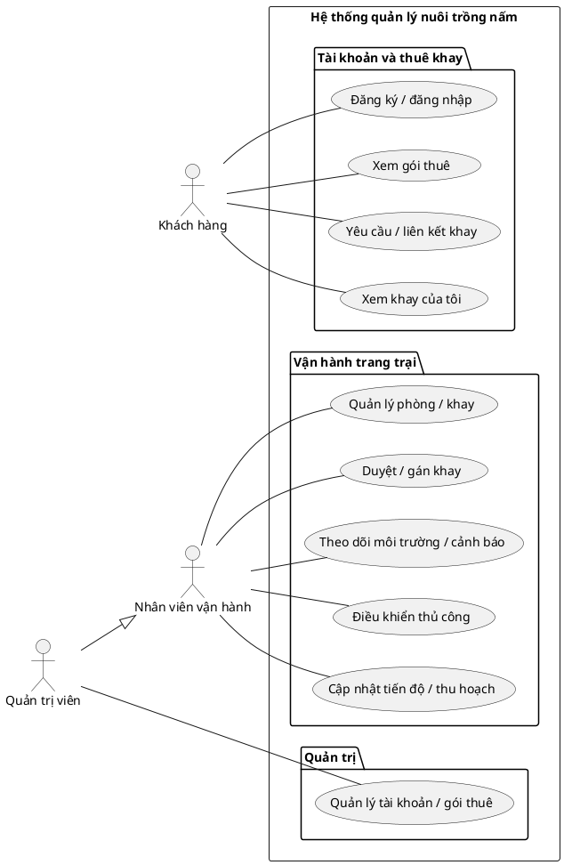

**Use Case chi tiết — thuê và liên kết khay:**
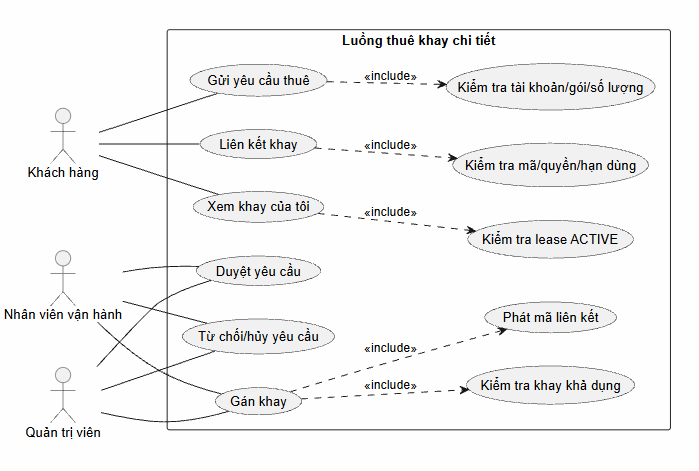

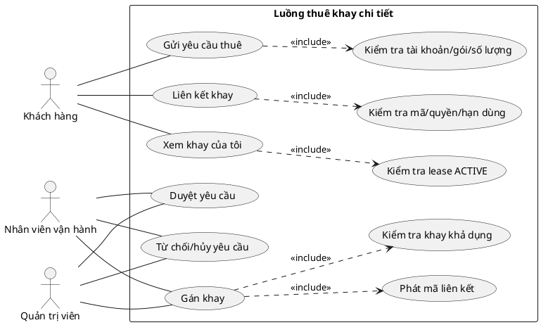

### 4. Biểu đồ Use Case theo từng tác nhân

**4.1. Khách hàng**
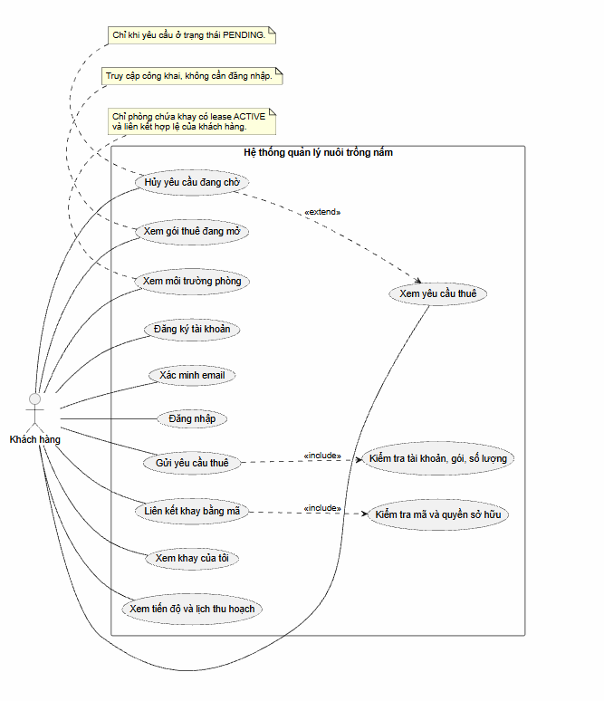

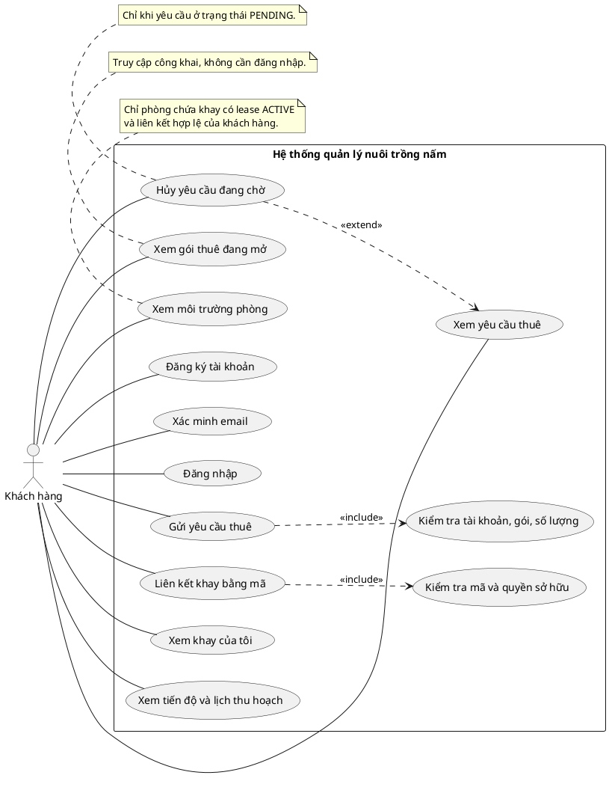

**4.2. Nhân viên vận hành**
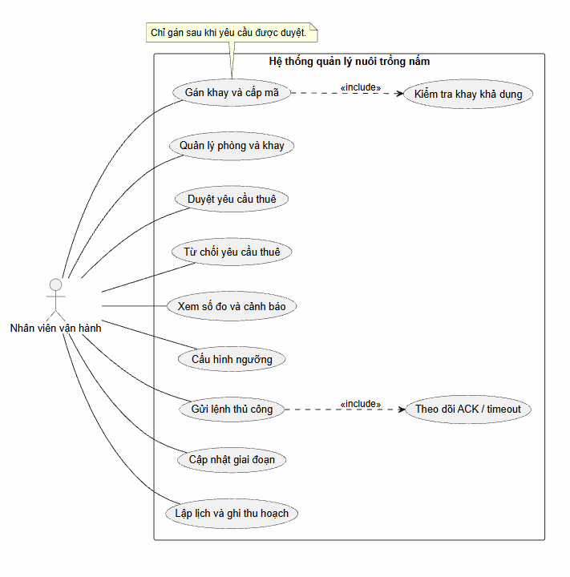

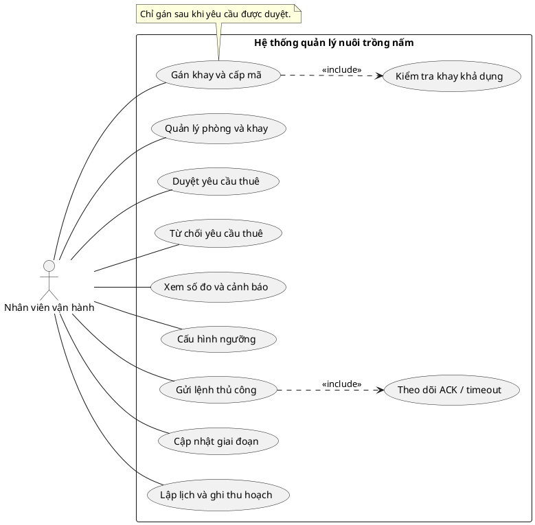

**4.3. Quản trị viên**
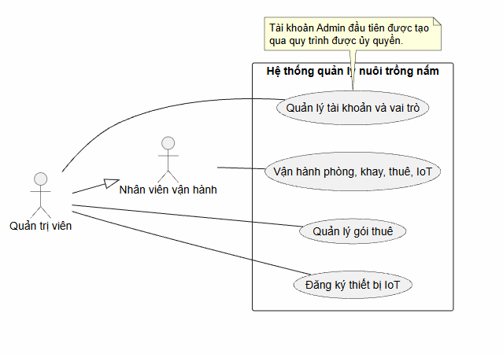

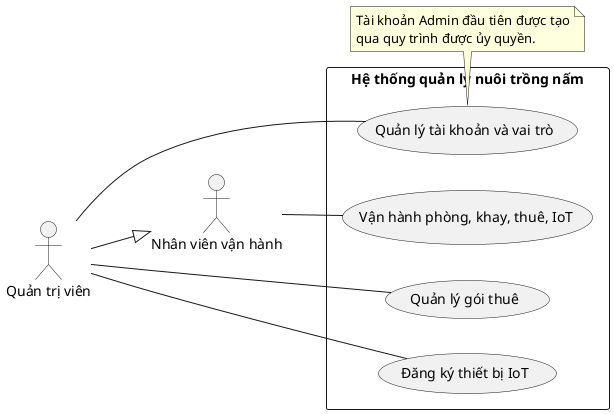

### 5. Biểu đồ hoạt động của các chức năng chính

**5.1. Đăng ký, xác minh email và đăng nhập**
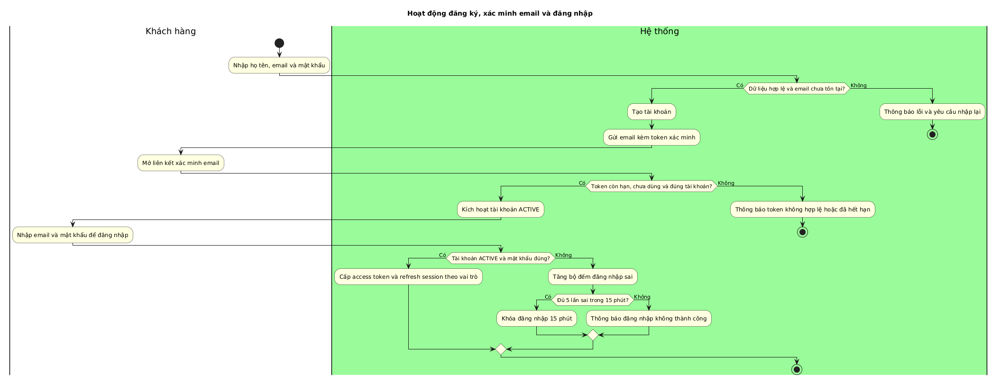

```
@startuml
title Hoạt động đăng ký, xác minh email và đăng nhập

!pragma useVerticalIf on

skinparam shadowing false
skinparam activity {
    BackgroundColor LightYellow
}

|Khách hàng|
start
:Nhập họ tên, email và mật khẩu;

|#palegreen|Hệ thống|
if (Dữ liệu hợp lệ và email chưa tồn tại?) then (Có)
    :Tạo tài khoản;
    :Gửi email kèm token xác minh;

    |Khách hàng|
    :Mở liên kết xác minh email;

    |#palegreen|Hệ thống|
    if (Token còn hạn, chưa dùng và đúng tài khoản?) then (Có)
        :Kích hoạt tài khoản ACTIVE;

        |Khách hàng|
        :Nhập email và mật khẩu để đăng nhập;

        |#palegreen|Hệ thống|
        if (Tài khoản ACTIVE và mật khẩu đúng?) then (Có)
            :Cấp access token và refresh session theo vai trò;
        else (Không)
            :Tăng bộ đếm đăng nhập sai;

            if (Đủ 5 lần sai trong 15 phút?) then (Có)
                :Khóa đăng nhập 15 phút;
            else (Không)
                :Thông báo đăng nhập không thành công;
            endif
        endif
    else (Không)
        :Thông báo token không hợp lệ hoặc đã hết hạn;
        stop
    endif
else (Không)
    :Thông báo lỗi và yêu cầu nhập lại;
    stop
endif

|#palegreen|Hệ thống|
stop

@enduml
```

**5.2. Quản lý phòng, khay, gói thuê và thiết bị**
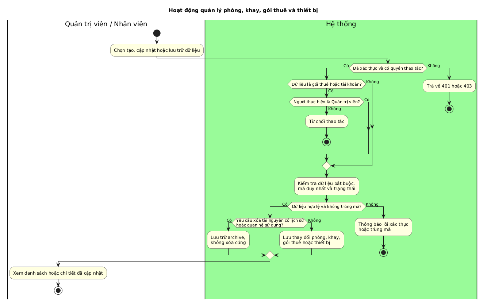

```
@startuml
title Hoạt động quản lý phòng, khay, gói thuê và thiết bị

!pragma useVerticalIf on

skinparam shadowing false
skinparam activity {
    BackgroundColor LightYellow
}

|Quản trị viên / Nhân viên|
start
:Chọn tạo, cập nhật hoặc lưu trữ dữ liệu;

|#palegreen|Hệ thống|
if (Đã xác thực và có quyền thao tác?) then (Có)
    if (Dữ liệu là gói thuê hoặc tài khoản?) then (Có)
        if (Người thực hiện là Quản trị viên?) then (Có)
        else (Không)
            :Từ chối thao tác;
            stop
        endif
    else (Không)
    endif

    :Kiểm tra dữ liệu bắt buộc,\nmã duy nhất và trạng thái;

    if (Dữ liệu hợp lệ và không trùng mã?) then (Có)
        if (Yêu cầu xóa tài nguyên có lịch sử\nhoặc quan hệ sử dụng?) then (Có)
            :Lưu trữ archive,\nkhông xóa cứng;
        else (Không)
            :Lưu thay đổi phòng, khay,\ngói thuê hoặc thiết bị;
        endif

        |Quản trị viên / Nhân viên|
        :Xem danh sách hoặc chi tiết đã cập nhật;
        stop
    else (Không)
        |#palegreen|Hệ thống|
        :Thông báo lỗi xác thực\nhoặc trùng mã;
        stop
    endif
else (Không)
    :Trả về 401 hoặc 403;
    stop
endif

@enduml
```

**5.3. Thuê và liên kết khay**
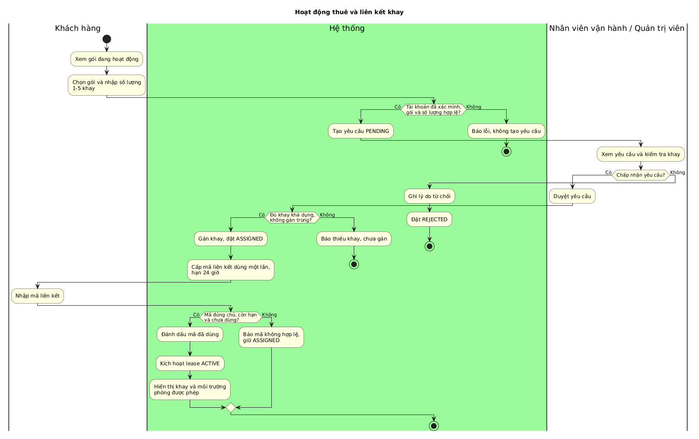

```
@startuml
title Hoạt động thuê và liên kết khay

!pragma useVerticalIf on

skinparam shadowing false
skinparam backgroundColor white
skinparam activity {
    BackgroundColor LightYellow
}

|Khách hàng|
start
:Xem gói đang hoạt động;
:Chọn gói và nhập số lượng\n1–5 khay;

|#palegreen|Hệ thống|
if (Tài khoản đã xác minh,\ngói và số lượng hợp lệ?) then (Có)
    :Tạo yêu cầu PENDING;

    |Nhân viên vận hành / Quản trị viên|
    :Xem yêu cầu và kiểm tra khay;

    if (Chấp nhận yêu cầu?) then (Có)
        :Duyệt yêu cầu;

        |#palegreen|Hệ thống|
        if (Đủ khay khả dụng,\nkhông gán trùng?) then (Có)
            :Gán khay, đặt ASSIGNED;
            :Cấp mã liên kết dùng một lần,\nhạn 24 giờ;

            |Khách hàng|
            :Nhập mã liên kết;

            |#palegreen|Hệ thống|
            if (Mã đúng chủ, còn hạn\nvà chưa dùng?) then (Có)
                :Đánh dấu mã đã dùng;
                :Kích hoạt lease ACTIVE;
                :Hiển thị khay và môi trường\nphòng được phép;
            else (Không)
                :Báo mã không hợp lệ,\ngiữ ASSIGNED;
            endif
        else (Không)
            :Báo thiếu khay, chưa gán;
            stop
        endif
    else (Không)
        :Ghi lý do từ chối;

        |#palegreen|Hệ thống|
        :Đặt REJECTED;
        stop
    endif
else (Không)
    :Báo lỗi, không tạo yêu cầu;
    stop
endif

stop
@enduml
```

**5.4. Giám sát môi trường và cảnh báo**
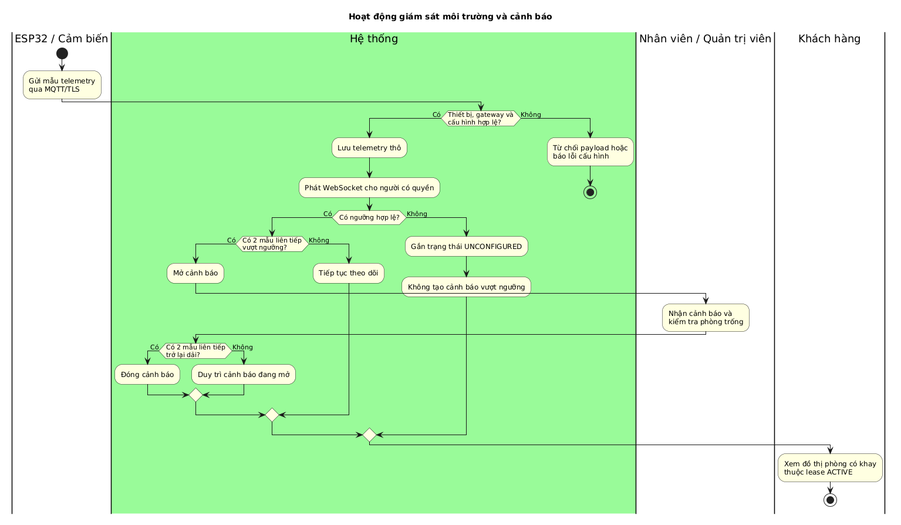

```
@startuml
title Hoạt động giám sát môi trường và cảnh báo

!pragma useVerticalIf on

skinparam shadowing false
skinparam backgroundColor white
skinparam activity {
    BackgroundColor LightYellow
}

|ESP32 / Cảm biến|
start
:Gửi mẫu telemetry\nqua MQTT/TLS;

|#palegreen|Hệ thống|
if (Thiết bị, gateway và\ncấu hình hợp lệ?) then (Có)
    :Lưu telemetry thô;
    :Phát WebSocket cho người có quyền;

    if (Có ngưỡng hợp lệ?) then (Có)
        if (Có 2 mẫu liên tiếp\nvượt ngưỡng?) then (Có)
            :Mở cảnh báo;

            |Nhân viên / Quản trị viên|
            :Nhận cảnh báo và\nkiểm tra phòng trống;

            |#palegreen|Hệ thống|
            if (Có 2 mẫu liên tiếp\ntrở lại dải?) then (Có)
                :Đóng cảnh báo;
            else (Không)
                |#palegreen|Hệ thống|
                :Duy trì cảnh báo đang mở;
            endif
        else (Không)
            |#palegreen|Hệ thống|
            :Tiếp tục theo dõi;
        endif
    else (Không)
        |#palegreen|Hệ thống|
        :Gắn trạng thái UNCONFIGURED;
        :Không tạo cảnh báo vượt ngưỡng;
    endif

    |Khách hàng|
    :Xem đồ thị phòng có khay\nthuộc lease ACTIVE;
    stop
else (Không)
    |#palegreen|Hệ thống|
    :Từ chối payload hoặc\nbáo lỗi cấu hình;
    stop
endif

@enduml
```

**5.5. Điều khiển thiết bị thủ công**

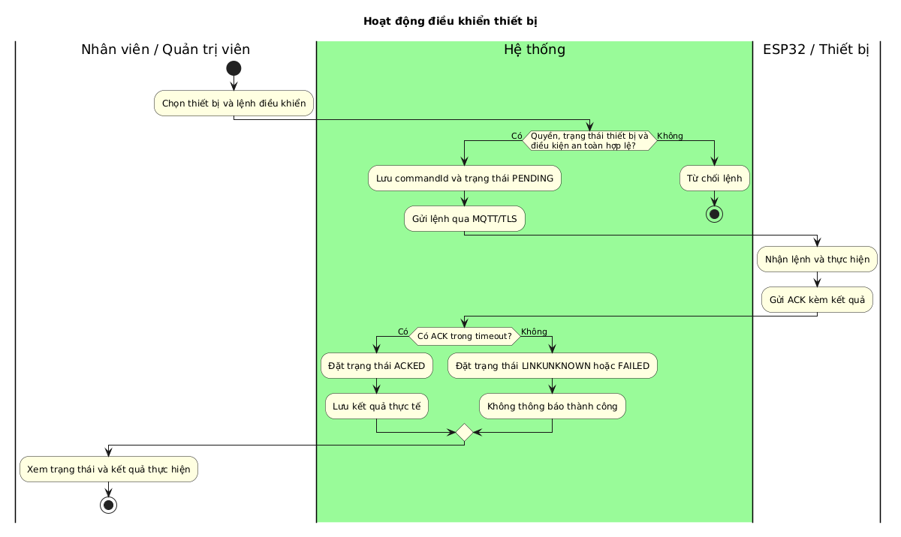

```
@startuml
title Hoạt động điều khiển thiết bị

!pragma useVerticalIf on

skinparam shadowing false
skinparam backgroundColor white
skinparam activity {
    BackgroundColor LightYellow
}

|Nhân viên / Quản trị viên|
start
:Chọn thiết bị và lệnh điều khiển;

|#palegreen|Hệ thống|
if (Quyền, trạng thái thiết bị và\nđiều kiện an toàn hợp lệ?) then (Có)
    :Lưu commandId và trạng thái PENDING;
    :Gửi lệnh qua MQTT/TLS;

    |ESP32 / Thiết bị|
    :Nhận lệnh và thực hiện;
    :Gửi ACK kèm kết quả;

    |#palegreen|Hệ thống|
    if (Có ACK trong timeout?) then (Có)
        :Đặt trạng thái ACKED;
        :Lưu kết quả thực tế;
    else (Không)
        |#palegreen|Hệ thống|
        :Đặt trạng thái LINKUNKNOWN hoặc FAILED;
        :Không thông báo thành công;
    endif

    |Nhân viên / Quản trị viên|
    :Xem trạng thái và kết quả thực hiện;
    stop
else (Không)
    |#palegreen|Hệ thống|
    :Từ chối lệnh;
    stop
endif

@enduml
```

**5.6. Cập nhật tiến độ và ghi nhận thu hoạch**
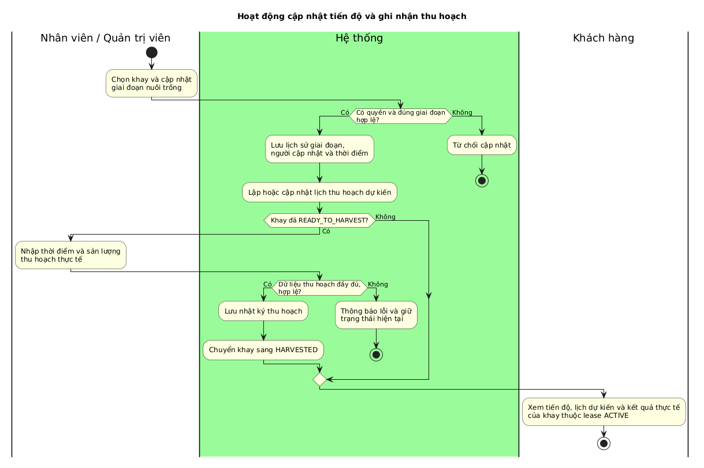

```
@startuml
title Hoạt động cập nhật tiến độ và ghi nhận thu hoạch

!pragma useVerticalIf on

skinparam shadowing false
skinparam backgroundColor white
skinparam activity {
    BackgroundColor LightYellow
}

|Nhân viên / Quản trị viên|
start
:Chọn khay và cập nhật\ngiai đoạn nuôi trồng;

|#palegreen|Hệ thống|
if (Có quyền và đúng giai đoạn\nhợp lệ?) then (Có)
    :Lưu lịch sử giai đoạn,\nngười cập nhật và thời điểm;
    :Lập hoặc cập nhật lịch thu hoạch dự kiến;

    if (Khay đã READY_TO_HARVEST?) then (Có)
        |Nhân viên / Quản trị viên|
        :Nhập thời điểm và sản lượng\nthu hoạch thực tế;

        |#palegreen|Hệ thống|
        if (Dữ liệu thu hoạch đầy đủ,\nhợp lệ?) then (Có)
            :Lưu nhật ký thu hoạch;
            :Chuyển khay sang HARVESTED;
        else (Không)
            |#palegreen|Hệ thống|
            :Thông báo lỗi và giữ\ntrạng thái hiện tại;
            stop
        endif
    else (Không)
        |#palegreen|Hệ thống|
    endif

    |Khách hàng|
    :Xem tiến độ, lịch dự kiến và kết quả thực tế\ncủa khay thuộc lease ACTIVE;
    stop
else (Không)
    |#palegreen|Hệ thống|
    :Từ chối cập nhật;
    stop
endif

@enduml
```

### 6. Sơ đồ tuần tự

**6.1. Đăng ký, xác minh email và đăng nhập**

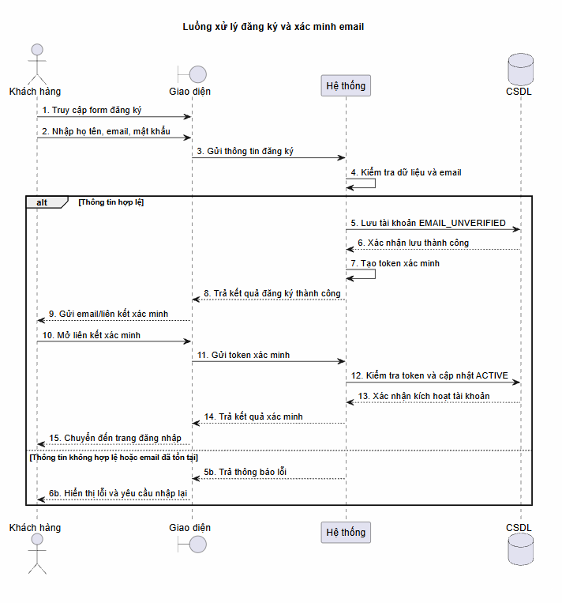

```
@startuml
title Luồng xử lý đăng ký và xác minh email

actor "Khách hàng" as customer
boundary "Giao diện" as ui
participant "Hệ thống" as system
database "CSDL" as db

customer -> ui: 1. Truy cập form đăng ký
customer -> ui: 2. Nhập họ tên, email, mật khẩu
ui -> system: 3. Gửi thông tin đăng ký
system -> system: 4. Kiểm tra dữ liệu và email

alt Thông tin hợp lệ
    system -> db: 5. Lưu tài khoản EMAIL_UNVERIFIED
    db --> system: 6. Xác nhận lưu thành công
    system -> system: 7. Tạo token xác minh
    system --> ui: 8. Trả kết quả đăng ký thành công
    ui --> customer: 9. Gửi email/liên kết xác minh
    customer -> ui: 10. Mở liên kết xác minh
    ui -> system: 11. Gửi token xác minh
    system -> db: 12. Kiểm tra token và cập nhật ACTIVE
    db --> system: 13. Xác nhận kích hoạt tài khoản
    system --> ui: 14. Trả kết quả xác minh
    ui --> customer: 15. Chuyển đến trang đăng nhập
else Thông tin không hợp lệ hoặc email đã tồn tại
    system --> ui: 5b. Trả thông báo lỗi
    ui --> customer: 6b. Hiển thị lỗi và yêu cầu nhập lại
end

@enduml
```

**6.2. Quản lý phòng, khay, gói thuê và thiết bị**
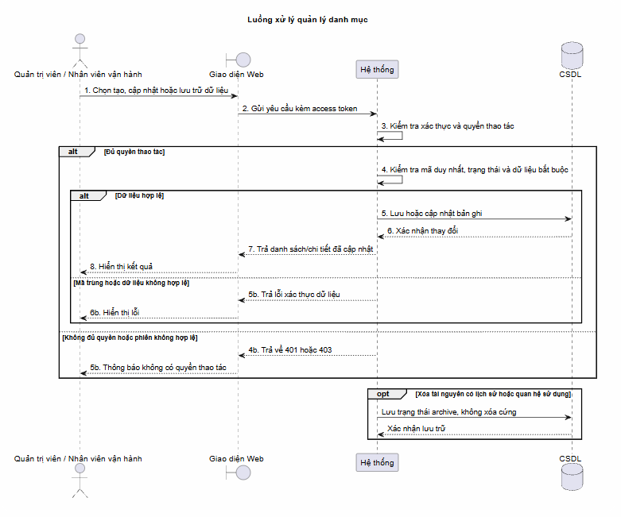

```
@startuml
title Luồng xử lý quản lý danh mục

actor "Quản trị viên / Nhân viên vận hành" as staff
boundary "Giao diện Web" as web
participant "Hệ thống" as system
database "CSDL" as db

staff -> web: 1. Chọn tạo, cập nhật hoặc lưu trữ dữ liệu
web -> system: 2. Gửi yêu cầu kèm access token
system -> system: 3. Kiểm tra xác thực và quyền thao tác

alt Đủ quyền thao tác
    system -> system: 4. Kiểm tra mã duy nhất, trạng thái và dữ liệu bắt buộc

    alt Dữ liệu hợp lệ
        system -> db: 5. Lưu hoặc cập nhật bản ghi
        db --> system: 6. Xác nhận thay đổi
        system --> web: 7. Trả danh sách/chi tiết đã cập nhật
        web --> staff: 8. Hiển thị kết quả
    else Mã trùng hoặc dữ liệu không hợp lệ
        system --> web: 5b. Trả lỗi xác thực dữ liệu
        web --> staff: 6b. Hiển thị lỗi
    end

else Không đủ quyền hoặc phiên không hợp lệ
    system --> web: 4b. Trả về 401 hoặc 403
    web --> staff: 5b. Thông báo không có quyền thao tác
end

opt Xóa tài nguyên có lịch sử hoặc quan hệ sử dụng
    system -> db: Lưu trạng thái archive, không xóa cứng
    db --> system: Xác nhận lưu trữ
end

@enduml
```

**6.3. Thuê và liên kết khay**
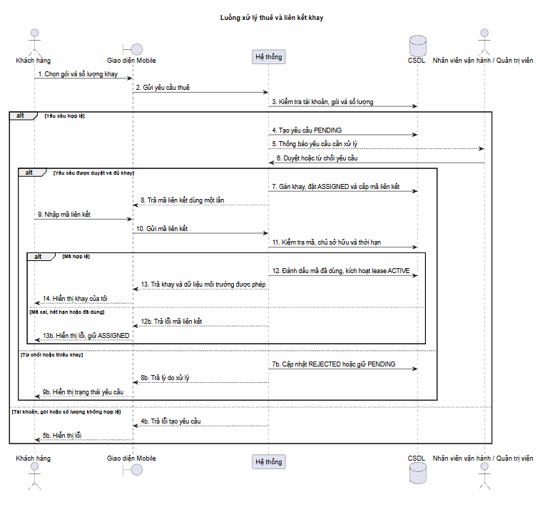

```
@startuml
title Luồng xử lý thuê và liên kết khay

actor "Khách hàng" as customer
boundary "Giao diện Mobile" as mobile
participant "Hệ thống" as system
database "CSDL" as db
actor "Nhân viên vận hành / Quản trị viên" as staff

customer -> mobile: 1. Chọn gói và số lượng khay
mobile -> system: 2. Gửi yêu cầu thuê
system -> db: 3. Kiểm tra tài khoản, gói và số lượng

alt Yêu cầu hợp lệ
    system -> db: 4. Tạo yêu cầu PENDING
    system --> staff: 5. Thông báo yêu cầu cần xử lý
    staff -> system: 6. Duyệt hoặc từ chối yêu cầu

    alt Yêu cầu được duyệt và đủ khay
        system -> db: 7. Gán khay, đặt ASSIGNED và cấp mã liên kết
        system --> mobile: 8. Trả mã liên kết dùng một lần
        customer -> mobile: 9. Nhập mã liên kết
        mobile -> system: 10. Gửi mã liên kết
        system -> db: 11. Kiểm tra mã, chủ sở hữu và thời hạn

        alt Mã hợp lệ
            system -> db: 12. Đánh dấu mã đã dùng, kích hoạt lease ACTIVE
            system --> mobile: 13. Trả khay và dữ liệu môi trường được phép
            mobile --> customer: 14. Hiển thị khay của tôi
        else Mã sai, hết hạn hoặc đã dùng
            system --> mobile: 12b. Trả lỗi mã liên kết
            mobile --> customer: 13b. Hiển thị lỗi, giữ ASSIGNED
        end

    else Từ chối hoặc thiếu khay
        system -> db: 7b. Cập nhật REJECTED hoặc giữ PENDING
        system --> mobile: 8b. Trả lý do xử lý
        mobile --> customer: 9b. Hiển thị trạng thái yêu cầu
    end

else Tài khoản, gói hoặc số lượng không hợp lệ
    system --> mobile: 4b. Trả lỗi tạo yêu cầu
    mobile --> customer: 5b. Hiển thị lỗi
end

@enduml
```

**6.4. Giám sát môi trường và cảnh báo**
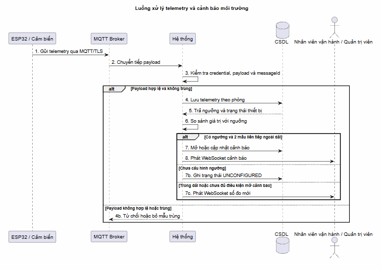

```
@startuml
title Luồng xử lý telemetry và cảnh báo môi trường

participant "ESP32 / Cảm biến" as sensor
participant "MQTT Broker" as broker
participant "Hệ thống" as system
database "CSDL" as db
actor "Nhân viên vận hành / Quản trị viên" as staff

sensor -> broker: 1. Gửi telemetry qua MQTT/TLS
broker -> system: 2. Chuyển tiếp payload
system -> system: 3. Kiểm tra credential, payload và messageId

alt Payload hợp lệ và không trùng
    system -> db: 4. Lưu telemetry theo phòng
    db --> system: 5. Trả ngưỡng và trạng thái thiết bị
    system -> system: 6. So sánh giá trị với ngưỡng

    alt Có ngưỡng và 2 mẫu liên tiếp ngoài dải
        system -> db: 7. Mở hoặc cập nhật cảnh báo
        system -> staff: 8. Phát WebSocket cảnh báo
    else Chưa cấu hình ngưỡng
        system -> db: 7b. Ghi trạng thái UNCONFIGURED
    else Trong dải hoặc chưa đủ điều kiện mở cảnh báo
        system -> staff: 7c. Phát WebSocket số đo mới
    end

else Payload không hợp lệ hoặc trùng
    system --> broker: 4b. Từ chối hoặc bỏ mẫu trùng
end

@enduml
```

**6.5. Điều khiển thiết bị thủ công**
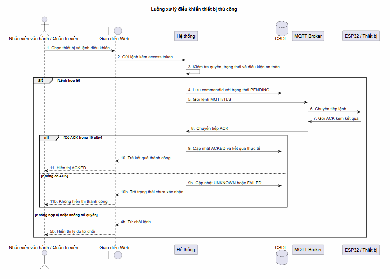

```
@startuml
title Luồng xử lý điều khiển thiết bị thủ công

actor "Nhân viên vận hành / Quản trị viên" as staff
boundary "Giao diện Web" as web
participant "Hệ thống" as system
database "CSDL" as db
participant "MQTT Broker" as broker
participant "ESP32 / Thiết bị" as device

staff -> web: 1. Chọn thiết bị và lệnh điều khiển
web -> system: 2. Gửi lệnh kèm access token
system -> system: 3. Kiểm tra quyền, trạng thái và điều kiện an toàn

alt Lệnh hợp lệ
    system -> db: 4. Lưu commandId với trạng thái PENDING
    system -> broker: 5. Gửi lệnh MQTT/TLS
    broker -> device: 6. Chuyển tiếp lệnh
    device -> broker: 7. Gửi ACK kèm kết quả
    broker -> system: 8. Chuyển tiếp ACK

    alt Có ACK trong 10 giây
        system -> db: 9. Cập nhật ACKED và kết quả thực tế
        system --> web: 10. Trả kết quả thành công
        web --> staff: 11. Hiển thị ACKED
    else Không có ACK
        system -> db: 9b. Cập nhật UNKNOWN hoặc FAILED
        system --> web: 10b. Trả trạng thái chưa xác nhận
        web --> staff: 11b. Không hiển thị thành công
    end

else Không hợp lệ hoặc không đủ quyền
    system --> web: 4b. Từ chối lệnh
    web --> staff: 5b. Hiển thị lý do từ chối
end

@enduml
```

**6.6. Cập nhật tiến độ và ghi nhận thu hoạch**
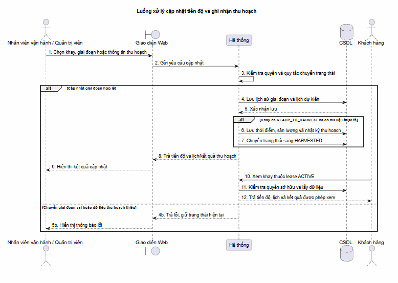

```
@startuml
title Luồng xử lý cập nhật tiến độ và ghi nhận thu hoạch

actor "Nhân viên vận hành / Quản trị viên" as staff
boundary "Giao diện Web" as web
participant "Hệ thống" as system
database "CSDL" as db
actor "Khách hàng" as customer

staff -> web: 1. Chọn khay, giai đoạn hoặc thông tin thu hoạch
web -> system: 2. Gửi yêu cầu cập nhật
system -> system: 3. Kiểm tra quyền và quy tắc chuyển trạng thái

alt Cập nhật giai đoạn hợp lệ
    system -> db: 4. Lưu lịch sử giai đoạn và lịch dự kiến
    db --> system: 5. Xác nhận lưu

    alt Khay đã READY_TO_HARVEST và có dữ liệu thực tế
        system -> db: 6. Lưu thời điểm, sản lượng và nhật ký thu hoạch
        system -> db: 7. Chuyển trạng thái sang HARVESTED
    end

    system --> web: 8. Trả tiến độ và lịch/kết quả thu hoạch
    web --> staff: 9. Hiển thị kết quả cập nhật

    customer -> system: 10. Xem khay thuộc lease ACTIVE
    system -> db: 11. Kiểm tra quyền sở hữu và lấy dữ liệu
    system --> customer: 12. Trả tiến độ, lịch và kết quả được phép xem

else Chuyển giai đoạn sai hoặc dữ liệu thu hoạch thiếu
    system --> web: 4b. Trả lỗi, giữ trạng thái hiện tại
    web --> staff: 5b. Hiển thị thông báo lỗi
end

@enduml
```

### 7. Luồng dữ liệu

| Dữ liệu                                | Nguồn                                   | Nơi lưu/xử lý                                     | Nơi nhận hợp lệ                                                |
| -------------------------------------- | --------------------------------------- | ------------------------------------------------- | -------------------------------------------------------------- |
| Tài khoản, role, lease, phòng/khay/gói | Web/Mobile qua REST                     | API kiểm quyền → PostgreSQL                       | Chủ tài khoản hoặc nhân viên đúng quyền                        |
| Telemetry nhiệt độ/độ ẩm/CO₂           | ESP32 → MQTT broker                     | API xác thực/dedupe → PostgreSQL; ngưỡng/cảnh báo | Web vận hành; Mobile Customer có khay ACTIVE trong phòng       |
| Lệnh và ACK                            | Web Operator/Admin → API → MQTT → ESP32 | Lưu commandId, actor, trạng thái và phản hồi      | Người vận hành được phép; Customer không nhận quyền điều khiển |
| Tiến độ và thu hoạch                   | Web Operator/Admin                      | API kiểm trạng thái → PostgreSQL                  | Customer có khay ACTIVE và nhân viên có quyền                  |

### 8. Trạng thái thực thể

**Yêu cầu/lease thuê khay:**
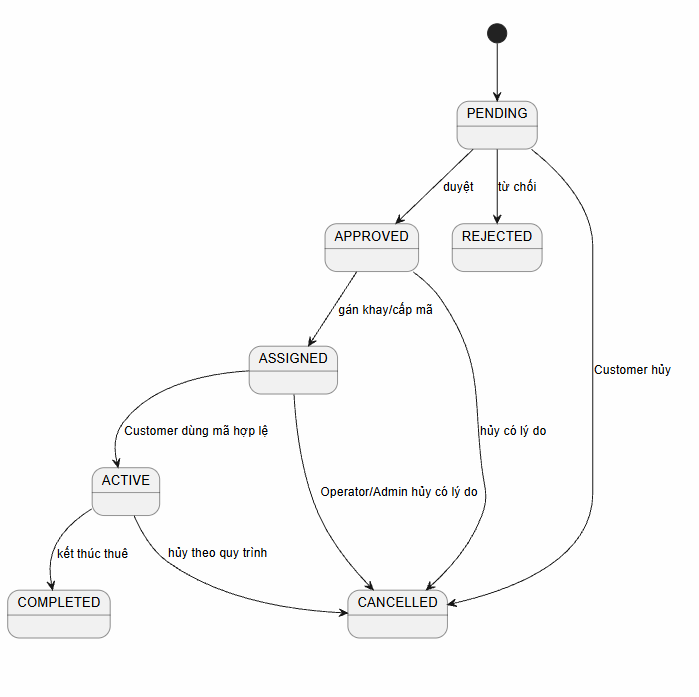

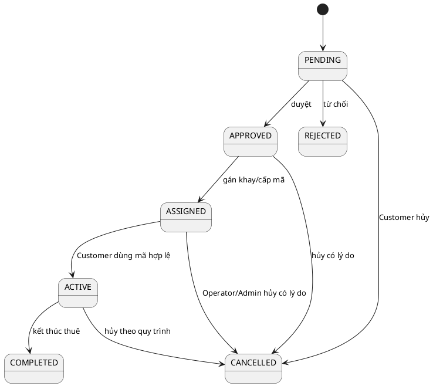

**Giai đoạn nuôi trồng:** `PREPARATION → INCUBATION → FRUITING → READY_TO_HARVEST → HARVESTED → COMPLETED`. Mọi lần chuyển lưu actor, thời điểm, ghi chú; không bỏ qua bước khi chưa có quy tắc cho phép.

# III. Yêu cầu phi chức năng

| Nhóm               | Mức yêu cầu                                                                                                                                                                | Cách xác minh                                        |
| ------------------ | -------------------------------------------------------------------------------------------------------------------------------------------------------------------------- | ---------------------------------------------------- |
| Hiệu năng          | P95 API đọc ≤2 giây, ghi ≤3 giây tại 10 người dùng đồng thời; đo riêng thời gian API, không cộng thời gian thiết bị.                                                       | Load test với dữ liệu 5 phòng, 50 khay, 50 thiết bị. |
| Realtime/IoT       | Mẫu hợp lệ lên client ≤5 giây kể từ lúc backend nhận; thiết bị gửi mặc định mỗi 30 giây; MQTT QoS 1, loại trùng `messageId`.                                               | So timestamp backend/client, replay message.         |
| Bảo mật            | HTTPS và MQTT/TLS 1.2+; mật khẩu Argon2id; API kiểm role và tài nguyên; không truy cập chéo khay; không ghi secret trong log.                                              | Kiểm cấu hình, RBAC/IDOR và log.                     |
| Tin cậy/an toàn    | Lỗi DB không trả thành công; lệnh thiếu ACK sau 10 giây không báo thành công; mất kết nối/stale không phát lệnh tự động.                                                   | Test lỗi DB, mất ACK/mất mạng.                       |
| Sao lưu/sẵn sàng   | Backup PostgreSQL hằng ngày; RPO ≤24 giờ, RTO ≤8 giờ; uptime mục tiêu ≥99,5%/tháng (trừ bảo trì đã thông báo).                                                             | Diễn tập restore; theo dõi uptime.                   |
| Quy mô/tương thích | Ít nhất 5 phòng, 50 khay, 50 thiết bị, 10 người dùng đồng thời; Chrome/Edge 3 bản ổn định gần nhất; Android 10+, iOS 15+.                                                  | Capacity test và ma trận thiết bị/trình duyệt.       |
| Giao diện/bảo trì  | Lỗi/validation bằng tiếng Việt, xác nhận thao tác phá hủy, luồng chính WCAG 2.1 AA; config/secret không hard-code; log có correlation ID, audit thay đổi role/ngưỡng/lệnh. | UAT, accessibility check, rà soát config/audit.      |

## V. Yêu cầu thiết kế

### 1. Mô hình kiến trúc

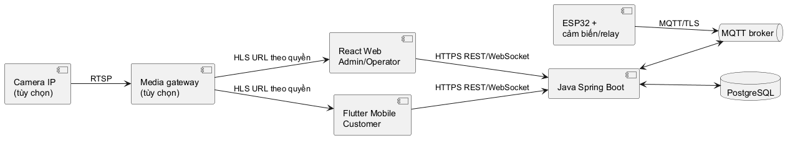

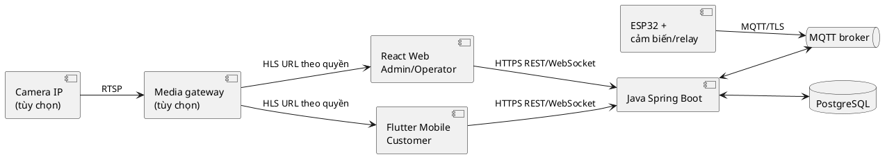

Backend là nơi xác thực, phân quyền, kiểm tra nghiệp vụ và lưu trạng thái. Web/Mobile không tự quyết định quyền hoặc trạng thái lease. Media gateway chỉ cần khi triển khai camera. Nếu phát triển điều khiển tự động, chức năng này mặc định tắt và chỉ được bật khi ngưỡng hợp lệ, dữ liệu mới, trạng thái an toàn đã được kiểm thử và không có lệnh thủ công đang được ưu tiên.

### 2. Mô hình cơ sở dữ liệu khái niệm

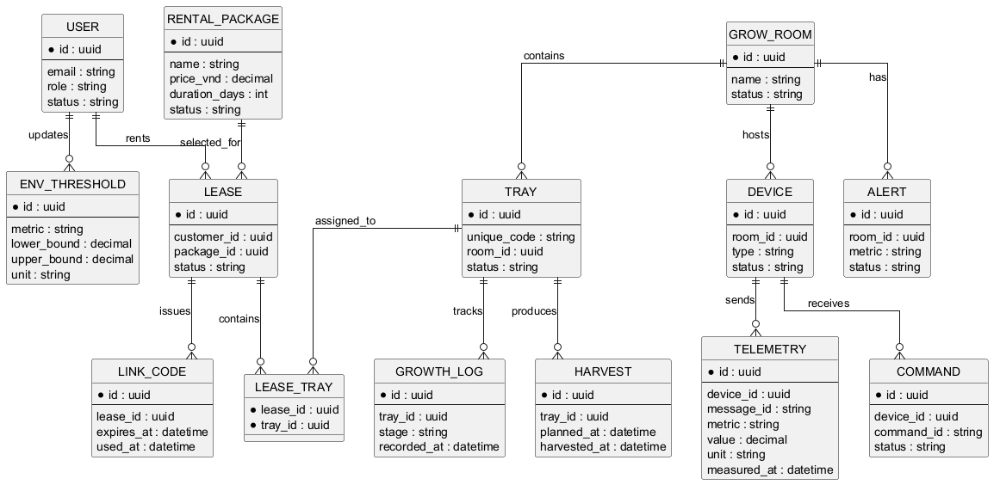

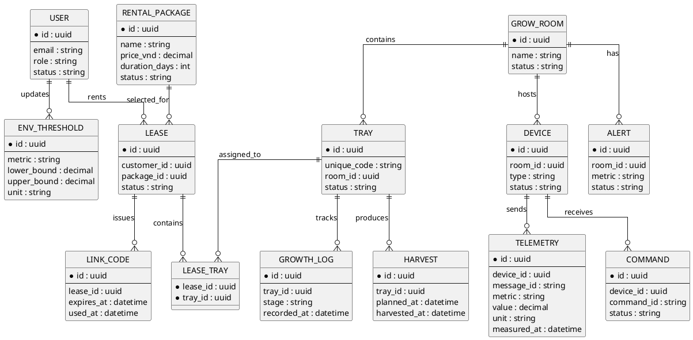

Đây là mô hình **khái niệm**, không phải migration PostgreSQL cuối cùng. Các ràng buộc vật lý bắt buộc: email/mã khay/ID thiết bị duy nhất; không có hai lease ACTIVE cho cùng khay; mã liên kết một lần và hạn 24 giờ; `messageId` và `commandId` chống xử lý lặp; telemetry gắn **Device → Room**, Customer xem qua **Room → Tray → Lease**. `ENV_THRESHOLD` lưu actor và thời điểm cập nhật, ngưỡng/đơn vị hợp lệ; không lưu ngưỡng mặc định giả định.

### 3. Giao diện người dùng

| Ứng dụng           | Màn hình chính cần triển khai                                                                                                                             | Yêu cầu hiển thị                                                                                                                                    |
| ------------------ | --------------------------------------------------------------------------------------------------------------------------------------------------------- | --------------------------------------------------------------------------------------------------------------------------------------------------- |
| Web Admin/Operator | Login, dashboard, người dùng (Admin), phòng/khay, gói (Admin), yêu cầu thuê/gán khay, thiết bị, môi trường/ngưỡng/cảnh báo, điều khiển, tiến độ/thu hoạch | Menu theo role; dữ liệu phòng và thời điểm đo rõ; lỗi và trạng thái offline/`UNCONFIGURED` dễ nhận biết; xác nhận trước lệnh hoặc thao tác phá hủy. |
| Mobile Customer    | Đăng ký/xác minh/login, gói thuê, yêu cầu thuê, nhập mã liên kết, khay của tôi, chi tiết khay/môi trường/tiến độ/lịch thu hoạch                           | Chỉ dữ liệu của khay ACTIVE; đơn vị °C/%RH/ppm và thời điểm đo rõ; danh sách trống, mạng lỗi, mã sai/hết hạn có thông báo tiếng Việt.               |

**Điều hướng tối thiểu:** Web `Đăng nhập → Dashboard → Danh mục/Thuê/IoT/Thu hoạch`; Mobile `Đăng ký hoặc Đăng nhập → Gói thuê → Yêu cầu thuê → Liên kết → Khay của tôi → Chi tiết khay`. Giao diện bảo vệ route nhưng backend vẫn phải kiểm tra quyền ở mọi API.
